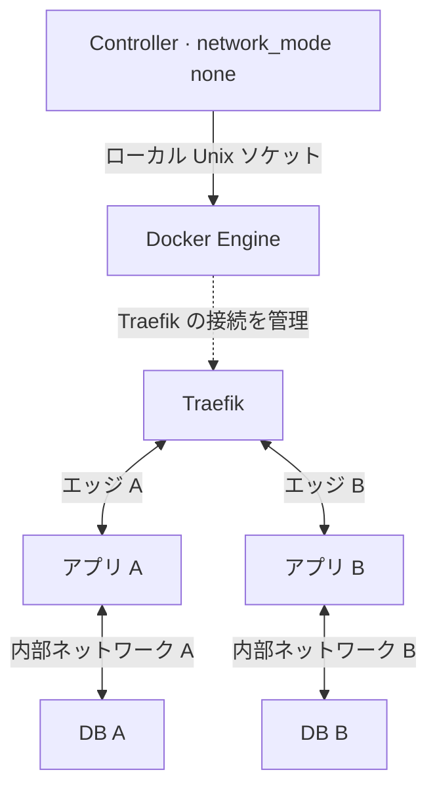
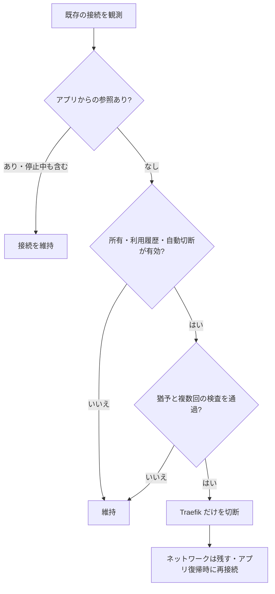

# Traefik Network Controller

[English](README.md) · **0.2.0** · [仕様](SPEC.ja.md) · [運用](docs/operations.ja.md) · [CLI](docs/cli.ja.md)

Traefik を **アプリごとのエッジネットワーク**へ接続する Rust 製 controller です。アプリ追加のたびに Traefik の中央 Compose を編集する必要をなくし、Traefik と同じ Compose project に独立サービスとして配置します。

任意で、アプリからのコンテナ参照がなくなり猶予時間が経過した接続を自動切断できます。対象は **controller が所有する Traefik 接続だけ**で、既定では無効です。初回利用前の準備済み接続、停止中コンテナの参照、固定ネットワーク、所有権が不明な接続は維持します。

> **検証状況:** 本番導入前に、使い捨ての実 Docker と実際の通信を使った受入検証が必要です。ビルドやポリシーのテストだけでは、これらの確認を代替できません。実施済みの証拠と未完了項目は [TESTING.md](TESTING.md) を参照してください。

## 構成



各 Web アプリは専用エッジを Traefik と共有し、DB はアプリ内部のネットワークに残します。別エッジに分けることで、無関係なアプリと同じ bridge を共有する経路をなくします。完全な分離には公開ポート、firewall、IPv6、他の接続、アプリの挙動も関係します。境界は [セキュリティ範囲](docs/security.ja.md) に説明しています。

controller は HTTP リスナーや LLM に依存しません。Traefik 用 Socket Proxy は既存の読み取り専用設定を維持し、controller は別のローカル Docker ソケットと永続的な所有権台帳を使います。**ソケットを `:ro` でマウントしても Docker API の書き込みは可能**なため、信頼する管理サービスとして扱います。

## 接続の判断



判断図は固定／保護対象を除いた既存接続を評価します。保護対象は現在の状態を維持します。未接続の非保護エッジはアプリ参照や初回準備で必要な場合に接続し、未使用の切断済みエッジは切断状態を保ちます。

ネットワークラベルは管理対象の識別に使いますが、既存の接続を所有している証拠にはなりません。既存・手動の接続を自動切断の対象にするには、ID を指定した明示的な `adopt` が必要です。自動処理でネットワークは削除しません。`retire APP` は参照確認後に空の管理対象エッジを明示的に削除する操作です。

## まず検証用環境で導入

必要条件は Linux Docker の API 対応範囲が **1.48–1.56** と重なること、Compose **2.33.1 以降**、既存 Traefik の名前・project・service が分かることです。これらは互換性の条件であり、前述の検証範囲を参照してください。

ソースを `~/traefik/traefik-network-controller/` に置き、既存の `compose.yaml` の隣に [examples/compose.overwrite.yaml](examples/compose.overwrite.yaml) をマージします。control／WAF／移行中の接続を残します。この例は `gw_priority: 100` の固定 egress を追加し、管理対象のエッジは `-1` にします。

```sh
cd ~/traefik
# Use the project label of the existing Traefik container.
docker inspect traefik --format '{{index .Config.Labels "com.docker.compose.project"}}'
export TNC_TARGET_PROJECT=your_existing_traefik_project

tnc_compose() {
  docker compose -p "$TNC_TARGET_PROJECT" \
    -f compose.yaml -f compose.overwrite.yaml "$@"
}

tnc_compose config -q
tnc_compose build --pull controller
# Initial egress setup may recreate Traefik and interrupt connections.
tnc_compose up -d --no-deps traefik
tnc_compose run --rm --no-deps controller plan
tnc_compose up -d --no-deps controller
```

起動前に計画を確認してください。`compose.overwrite.yaml` は意図したファイル名で、自動読込されないため毎回 `-f` で指定します。内部の `plan` は Docker を変更しませんが、`compose run` は補助コンテナを作成・削除します。[導入手順の詳細](docs/operations.ja.md) には識別情報の確認、移行、切り戻しを記載しています。

## アプリを追加

```sh
tnc_compose exec -T controller traefik-network-controller prepare echo
```

アプリ側の Compose に次を反映します。

```yaml
services:
  echo:
    labels:
      traefik.docker.network: traefik_app_echo
    networks: [edge]

networks:
  edge:
    external: true
    name: traefik_app_echo
```

ルーター、TLS／WAF、ストレージ、認証情報など既存設定を維持します。`edge` に参加するのは Web サービスだけとし、DB がある場合は別の内部ネットワークだけに参加させます。アプリの既存 Compose project でデプロイし、実際の経路を確認します。[Echo サンプル](examples/echo.compose.yaml) は `traefik/whoami:v1.12.0` をポート 8080 で使います。リクエストやヘッダーを返す検証用サービスなので、認証情報を送らないでください。以降のアプリ追加でも Traefik の Compose は変更しません。

## 運用と自動化

| 目的 | controller コンテナ内のコマンド |
| --- | --- |
| 導入済みの契約を調べる | `traefik-network-controller capabilities` |
| Docker を変更せず判断を確認 | `traefik-network-controller plan` |
| 現状／ポリシーを診断 | `traefik-network-controller status` / `traefik-network-controller doctor` |
| 新しい保存済み同期計画を適用 | `traefik-network-controller apply FILE_OR_DASH` |
| エッジを準備 | `traefik-network-controller prepare APP` |
| 検証済みの空エッジを明示的に削除 | `traefik-network-controller retire APP` |
| 最近のデーモン同期を確認 | `traefik-network-controller healthcheck` |

`TNC_AUTO_DETACH=true` は所有権・保持条件・猶予動作を検証してから設定します。猶予の既定値は 300 秒です。[運用ガイド](docs/operations.ja.md) に ID 指定の引き継ぎ、廃止、古い計画の拒否、状態復旧、監視、単一の管理系統という制約を記載しています。`status`、`doctor`、`healthcheck` は HTTP／TLS／WAF の可用性を証明しません。

## ライセンスと CI

本プロジェクトの独自部分は [MIT](LICENSE) です。依存関係と Rust ランタイムの表示はソースとイメージに同梱します。[ライセンス評価](docs/licensing.ja.md) を参照してください。

[GitHub Actions](.github/workflows/ci.yml) と [GitLab CI](.gitlab-ci.yml) に lint、locked ビルド、完全な Rust／CLI／モックテスト、ライセンス検査を用意しています。保護された版一致のタグから、検査済み `linux/amd64` イメージを公開します。GitHub は GHCR を標準として Docker Hub を任意で追加でき、GitLab は同じプロジェクトの Container Registry を使います。これらのファイルを用意した時点でリポジトリや registry の作成、イメージの公開は行っていません。

[公開準備](docs/releasing.ja.md) から、[GitHub](docs/ci-github.ja.md) または [GitLab](docs/ci-gitlab.ja.md) の設定へ進みます。リポジトリ／runner の保護と package の公開範囲は各サービス側で設定します。[TESTING.md](TESTING.md) でローカル検証、CI の実行、実環境の受入を分けて記録します。

## AI エージェントと開発者向け

- **運用:** [エージェントガイド](docs/agent-guide.ja.md)、リリースに一致する [用途別プロンプト](prompts/README.md)、同梱の [運用スキル](skills/traefik-network-operator/SKILL.md) を参照し、導入済みコマンドを確認して使います。
- **開発:** [AGENTS.md](AGENTS.md) と [SPEC.md](SPEC.md) の要件 ID・受入条件に変更を対応させ、[実装](prompts/implement-change.ja.md) と [レビュー](prompts/review-change.ja.md) のプロンプトを使います。
- **セキュリティ評価:** [脅威モデルと限界](docs/security.ja.md) を参照してください。プロンプトは運用を誘導し、コードは controller のポリシーを強制します。生の Docker 権限を持つエージェントへの外部的な制限にはなりません。

文書とスキルは、人やエージェントが採用可否を評価しやすくするためのものです。AI サービスによる自動発見、インストール、推薦、採用を保証するものではありません。
