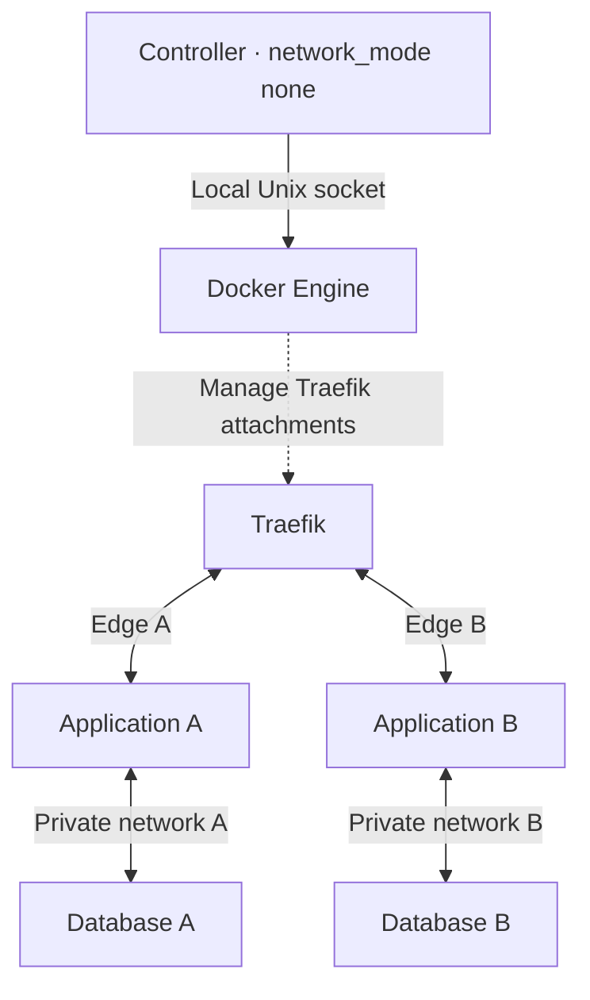
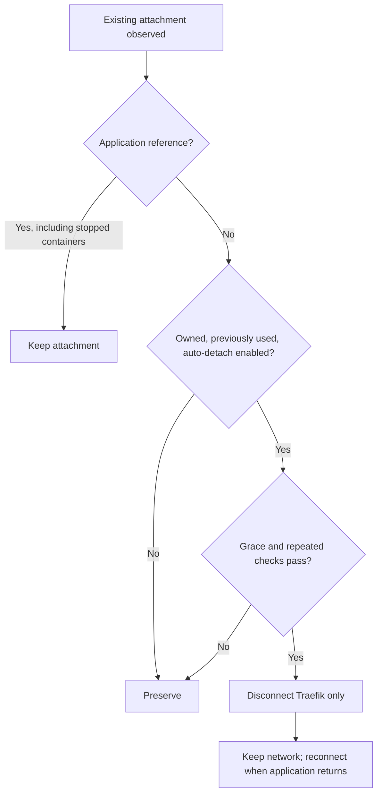

# Traefik Network Controller

[日本語](README.ja.md) · **0.2.0** · [Specification](SPEC.md) · [Operations](docs/operations.md) · [CLI](docs/cli.md) · [MIT](LICENSE)

A Rust controller that attaches Traefik to **one edge network per application**. Add an application without editing Traefik's central network list. Run the controller beside Traefik in the same Compose project.

Optional automatic cleanup disconnects only a controller-owned Traefik attachment after the application has no remaining container references and a grace period has passed. It is **off by default**. Prepared-but-never-used edges, stopped container references, fixed networks, and unowned attachments are preserved.

> **Validation status:** this source release still requires disposable real-Docker and routed-traffic acceptance before production use. Builds and policy tests do not establish those results. See [TESTING.md](TESTING.md) for the exact evidence and pending checks.

## What changes



Each web application shares an edge with Traefik. Its database remains on an application-internal network. A different edge removes the shared bridge path between unrelated applications; complete isolation still depends on host ports, firewall, IPv6, other attachments, and application behavior. [Security scope](docs/security.md) explains the boundary.

The controller has no HTTP listener or LLM dependency. Traefik keeps its existing read-only Docker Socket Proxy. The controller uses a separate local Docker socket and a persistent ownership journal. **A `:ro` socket mount still permits Docker API writes:** this is a trusted administrative service.

## Connection lifecycle



The diagram evaluates existing attachments after fixed/protected-network exclusion. Protected networks keep their observed state. A missing unprotected attachment is connected when an application reference or initial preparation requires it; a remembered unused detached edge stays detached.

Network labels identify a managed edge; they do not prove ownership of an existing connection. Pre-existing/manual attachments need an explicit, ID-pinned `adopt` before automatic detach. Automatic cleanup never deletes networks. `retire APP` explicitly removes an owned empty edge after reference checks.

## Start with a disposable deployment

Requirements: Linux Docker with an API range overlapping **1.48–1.56**, Compose **2.33.1+**, and the existing Traefik name/project/service identities. These are compatibility requirements; see the validation limitation above.

Place the source at `~/traefik/traefik-network-controller/` and merge [examples/compose.overwrite.yaml](examples/compose.overwrite.yaml) beside the existing `compose.yaml`. Keep existing control/WAF and migration attachments. The integration adds fixed egress with `gw_priority: 100`; managed edges use `-1`.

```sh
cd ~/traefik
# Use the project label of the existing Traefik container.
docker inspect traefik --format '{{index .Config.Labels "com.docker.compose.project"}}'
export TNC_TARGET_PROJECT=your_existing_traefik_project

tnc_compose() {
  docker compose -p "$TNC_TARGET_PROJECT" \
    -f compose.yaml -f compose.overwrite.yaml "$@"
}

tnc_compose config -q
tnc_compose build --pull controller
# Initial egress setup may recreate Traefik and interrupt connections.
tnc_compose up -d --no-deps traefik
tnc_compose run --rm --no-deps controller plan
tnc_compose up -d --no-deps controller
```

Review the plan before starting. The filename `compose.overwrite.yaml` is intentional and must be loaded explicitly with `-f`. The inner `plan` command does not change Docker; `compose run` creates/removes its helper container. [The full installation procedure](docs/operations.md#1-install-or-upgrade) covers identity checks, migration, and rollback.

## Add an application

```sh
tnc_compose exec -T controller traefik-network-controller prepare echo
```

In the application's own Compose file:

```yaml
services:
  echo:
    labels:
      traefik.docker.network: traefik_app_echo
    networks: [edge]

networks:
  edge:
    external: true
    name: traefik_app_echo
```

Retain the application's existing routing, TLS/WAF, storage and credentials. Only the intended web-facing service joins `edge`; application databases, if present, stay on a separate internal network. Deploy using the application's existing Compose project and verify its route. The [Echo example](examples/echo.compose.yaml) uses `traefik/whoami:v1.12.0` on port 8080. It returns request/header details: use it for testing and do not send credentials to it. Repeat per application; Traefik's Compose stays unchanged.

## Operate and automate

| Goal | Command inside the controller container |
| --- | --- |
| Discover the installed contract | `traefik-network-controller capabilities` |
| Inspect decisions without changing Docker | `traefik-network-controller plan` |
| Inspect current state / policy diagnosis | `traefik-network-controller status` / `traefik-network-controller doctor` |
| Apply a fresh saved reconciliation plan | `traefik-network-controller apply FILE_OR_DASH` |
| Prepare an edge | `traefik-network-controller prepare APP` |
| Explicitly delete a verified empty edge | `traefik-network-controller retire APP` |
| Check recent daemon reconciliation | `traefik-network-controller healthcheck` |

Set `TNC_AUTO_DETACH=true` only after validating ownership, retention, and grace behavior. The default grace is 300 seconds. [Operations](docs/operations.md) covers pinned adoption, safe retirement, stale plans, state recovery, monitoring and the one-writer requirement. `status`, `doctor`, and `healthcheck` do not prove HTTP/TLS/WAF availability.

## License and CI

Original project contributions are licensed under [MIT](LICENSE). Retained dependency and Rust-runtime notices accompany the source and container image; see [the license assessment](docs/licensing.md).

[GitHub Actions](.github/workflows/ci.yml) and [GitLab CI](.gitlab-ci.yml) run lint, locked builds, the complete Rust/CLI/mock tests and license checks. Protected, version-matched release tags publish tested `linux/amd64` images: GHCR by default (optional Docker Hub) on GitHub, and the project's Container Registry on GitLab. No registry/repository has been created or image published by preparing these files.

Start with [public release setup](docs/releasing.md), then follow the [GitHub](docs/ci-github.md) or [GitLab](docs/ci-gitlab.md) instructions. Repository/runner protections and package visibility require provider-side configuration. [TESTING.md](TESTING.md) separates local checks from hosted CI and live deployment acceptance.

## For AI agents and contributors

- **Operate:** start with [the agent guide](docs/agent-guide.md), release-matched [task prompts](prompts/README.md), and the distributed [operator skill](skills/traefik-network-operator/SKILL.md). Confirm installed commands before executing them.
- **Develop:** [AGENTS.md](AGENTS.md) and [SPEC.md](SPEC.md) map changes to requirements and acceptance cases. Use the [implementation](prompts/implement-change.md) and [review](prompts/review-change.md) prompts.
- **Review security:** read [the threat model and limits](docs/security.md). Prompts guide operations; code enforces controller policy. Neither is an external sandbox for an agent with raw Docker access.

Documentation and skills make the project easier for people and agents to evaluate. They do not guarantee discovery, installation, recommendation, or adoption by any AI service.
