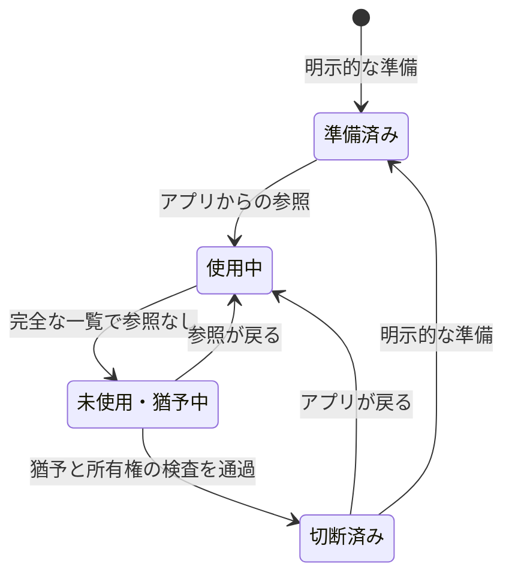

# Traefik Network Controller 仕様

**契約バージョン:** 0.2.0。**正本:** [SPEC.md](SPEC.md)（英語）。日本語版は同じ要件 ID を使います。

本仕様は、このソースリリースが満たすべき動作を定義します。要件の存在は、対応するすべての Docker バージョンで検証済みであることを意味しません。実施済みの検証と未完了の受入条件は [TESTING.md](TESTING.md) を参照してください。本番導入前には、実 Docker と Unix ソケットを使った受入検証が必要です。

## 1. 目的と対象

単一の Docker Engine 上で、明示的に識別した Traefik コンテナをアプリ別のエッジネットワークへ接続します。アプリ追加のたびに Traefik の中央 Compose のネットワーク一覧を編集する必要をなくします。任意で、アプリからの参照がなくなった接続のうち、controller が所有する Traefik 接続だけを自動切断します。

Rust の controller は決定的なルールで動作します。AI エージェントは、与えられた権限の範囲で設定作成、計画確認、公開 CLI の実行、結果検証を行えます。デーモンの動作に LLM、推論サービス、HTTP リスナー、MCP サーバーは不要です。

対象外は Kubernetes、Swarm、overlay／複数ホスト、アプリ自体のデプロイ、方向別ファイアウォール、汎用 Docker 管理、ネットワークの自動削除、および controller の正常性だけによるアプリ疎通の証明です。

## 2. 権限と識別

| ID | 必須要件 |
| --- | --- |
| SCOPE-001 | 設定した絶対パスのローカル Unix ソケットだけを使う。TCP、別の Docker context、`DOCKER_HOST` へ暗黙に切り替えない。 |
| SCOPE-002 | 書き込み前に対象の名前、Compose project、Compose service、稼働状態、完全な小文字のコンテナ ID を検証する。名前だけでは操作しない。 |
| SCOPE-003 | 正確な `traefik_app_<app>` 名、必須ラベル、既定のローカル bridge 属性が一致するエッジだけを管理する。接頭辞や単一ラベルだけでは権限を得ない。 |
| SCOPE-004 | 固定 egress の gateway priority は `100`、管理対象の接続は `-1` とする。優先度の誤りを切断して暗黙に修復しない。 |
| SCOPE-005 | 指定された固定ネットワークと必須 egress を保護する。保護ルールは管理候補の検出より優先する。 |
| AUTH-001 | Engine／ネットワーク名前空間ごとに、調整された単一 controller と状態ディレクトリを使う。`TNC_TARGET_PROJECT` は対象を選ぶもので、名前空間を分割しない。 |
| AUTH-002 | Traefik 用 Socket Proxy の読み取り専用設定を維持する。controller のために Docker 書き込み権限を追加しない。 |

アプリ識別子は `[a-z0-9][a-z0-9_-]{0,47}` とします。管理対象エッジには、次のラベルを正確に設定します。

```yaml
com.nofmem.traefik.autojoin: "true"
com.nofmem.traefik.role: application-edge
com.nofmem.traefik.owner: <app>
```

`Internal`、`Ingress`、`ConfigOnly` は false、`Driver` は `bridge`、`Scope` は `local` とします。カスタム driver option は拒否します。0.1.0 からの移行のため名前空間を維持し、このリリースで別のラベル規約は導入しません。

ソケットを `:ro` でマウントしても Docker API の書き込みは可能です。controller は信頼する Docker 管理者に相当します。生のソケットを持つプロセスに対し、コードやプロンプトの検査は外部の権限制限にはなりません。アプリへソケットや controller の状態ボリュームを渡してはいけません。

## 3. 接続の所有権

ネットワークの所有権と、そのネットワークへの接続の所有権は別です。

| ID | 必須要件 |
| --- | --- |
| OWN-001 | 自動切断の根拠となる controller 識別情報、完全な対象コンテナ ID、ネットワーク ID、確認済み EndpointID、所有権の由来を永続化する。 |
| OWN-002 | 既存接続や手動接続を自動的に所有しない。接続 API の結果が曖昧で、その後の inspect で接続を発見しただけでは所有権を得ない。 |
| OWN-003 | 利用者が期待する対象・ネットワーク・エンドポイントの ID をすべて指定し、現在のポリシーがその接続を検証した場合に限り、明示的な引き継ぎを許可する。 |
| OWN-004 | 対象、ネットワーク、エンドポイントの再作成後に、名前の一致だけで所有権を移さない。新しい世代を再評価する。 |
| OWN-005 | 制限された永続領域へ状態を原子的に保存する。状態消失や不確かな接続結果で切断を許可しない。壊れた／不安全な状態を黙って初期化しない。 |

Docker の変更とローカルの状態保存は単一トランザクションではありません。接続成功後に所有権を永続的に確認できない場合は、接続を保守的に残して不確実性を報告します。明示的な引き継ぎも、対象・ネットワーク・保護ルールの検査を省略する手段ではありません。

## 4. 望ましい状態と自動切断

### 4.1 ライフサイクル



図は状態の意味を示します。表示名が JSON の値と同一とは限りません。出力の具体的な形式は [CLI 契約](docs/cli.ja.md) を参照してください。

| 状態 | 必要な動作 |
| --- | --- |
| 準備済み | 初回デプロイ前に準備した空のエッジは接続したまま維持できる。まだ起動していないことを廃止と解釈しない。 |
| 使用中 | 対象 Traefik 以外のコンテナから参照される間は維持する。停止中のコンテナも含める。 |
| 未使用・猶予中 | 一度使われた所有接続について完全な観測で参照がなくなった場合、猶予期間と追加の正常な観測を待つ。 |
| 切断済み | 所有する Traefik 接続だけを削除する。ネットワークが残っているだけで即座に再接続しない。アプリの復帰や明示的な準備で再接続できる。 |

準備後に一度も使わなかったエッジは明示的に廃止します。このリリースでは、準備予約に自動失効時間を設けません。

### 4.2 安全条件

| ID | 必須要件 |
| --- | --- |
| LIFE-001 | `TNC_AUTO_DETACH=false` を既定にする。有効化は明示的なポリシー変更とする。接続専用の運用を維持する。 |
| LIFE-002 | 停止中を含む全コンテナの参照を調べる。stop、die、unhealthy、HTTP エラーをアプリ廃止の根拠にしない。 |
| LIFE-003 | 破壊的な判断には完全に検証されたスナップショットを要求する。API エラー、タイムアウト、認可失敗、不正な一覧を空集合として扱わない。 |
| LIFE-004 | 設定された猶予時間と複数回の正常な観測を要求する。参照復帰で切断待ちを取り消す。再起動前の経過時間だけを使って直ちに切断しない。 |
| LIFE-005 | デーモン、単発同期、計画、準備、アプリ復帰で同じ望ましい状態のルールを使う。 |
| LIFE-006 | 切断直前に対象・ネットワーク・エンドポイントの所有権、保護、参照を再検証し、切断後に実際の接続状態を確認する。 |
| LIFE-007 | 自動処理はネットワークを削除せず、他のコンテナを切断せず、`Force=true` や prune を使わない。 |
| LIFE-008 | controller の停止時に既存接続を残す。イベントを同期の契機とし、起動時・定期スナップショットで取りこぼしを回復する。 |

猶予時間の既定値は 300 秒です。関連ポリシー変更、デーモン起動、kernel boot ID の変更、観測／変更エラー、観測の不連続では保守的に猶予をやり直します。読み取り report は再設定の計算結果を保存せず、古い計画の拒否そのものでも台帳を更新しません。猶予はデプロイ中の一時的な空白を許容するもので、不完全な観測を証拠に変えません。停止中コンテナの参照が残る限り、経過時間に関係なく自動切断を止めます。

### 4.3 明示的な廃止

`retire APP` は自動切断とは別です。全コンテナ参照を確認し、検証した Traefik だけを切断した後、管理対象の空のネットワークを削除できます。アプリコンテナ、データボリューム、別のネットワークは削除しません。明示的な廃止では、検証済みの未使用接続が unowned でも切断できますが、自動切断では許可しません。対象アプリを廃止する間は、そのアプリのデプロイ、起動、接続変更を止めておきます。

### 4.4 並行操作の限界

[Docker の切断 API](https://docs.docker.com/reference/api/engine/version/v1.56/) はネットワーク識別情報と `Container`／`Force` を受け取りますが、「期待する EndpointID が現在も同じなら切断する」という比較条件を持ちません。完全な ID と直前の確認で誤操作を減らせますが、独立した Docker 管理者との競合をすべて排除することはできません。

controller のファイルロックは同じ状態ディレクトリを共有するプロセス間だけを調整します。外部の Compose や Docker CLI はロックされません。管理対象の接続変更は単一の管理系統で調整します。任意の Docker 操作と同時実行しても完全に安全であるとは表現しません。

## 5. 計画・適用・診断

| ID | 必須要件 |
| --- | --- |
| PLAN-001 | `plan`、`status`、`doctor` は Docker を変更せず、接続所有権の取得やライフサイクルの更新をしない。ローカルの調整用ロックは許可する。 |
| PLAN-002 | 保存計画には対象・ポリシー・観測資源を特定する情報を含める。`apply` は再観測し、重要な前提が変化した計画を拒否する。 |
| PLAN-003 | 計画、ハッシュ、プロンプト、ラベルを権限の根拠にしない。現在のポリシーから許可動作を再計算し、入力 JSON の任意の操作を実行しない。 |
| PLAN-004 | `TNC_DRY_RUN` を追加の変更防止条件として維持する。計画を適用済みのように表示しない。 |
| PLAN-005 | 部分実行や観測失敗を全体成功と報告しない。完了した操作の証拠を残し、次回の検証済み同期で安全に回復する。 |
| OPS-001 | Docker が動作していなくてもバージョンと実装済み能力を確認できる。提案段階のコマンドを実装済みと書かない。 |
| OPS-002 | バージョン付きの構造化出力、安定した判断理由、量を制限した診断情報、文書化した終了コードを使う。生の環境変数や認証情報を出力しない。 |
| OPS-003 | 接続・切断・維持・保留／不確実な判断、観測の完全性、変更後の確認を区別して示す。 |
| OPS-004 | 共有操作ロックで変更を直列化し、同じ状態領域の二重デーモンを拒否する。 |
| OPS-005 | デーモンの正常性はデーモンだけが更新する。最近の同期と識別情報を確認するもので、TLS／WAF／アプリの疎通や分離を証明しない。 |

「Docker を変更しない」は controller 内部のコマンドについての性質です。`docker compose run` 自体は補助コンテナを作成・削除し、状態ボリュームを作る場合があります。既存コンテナへの照会には `docker compose exec -T` を使えます。内部コマンドと呼び出し方法の副作用を区別します。

保存計画は 300 秒で失効し、台帳や観測資源の変更でそれ以前に無効になる場合もあります。`prepare APP` は完全な snapshot を検証しますが、変更は指定エッジだけに限定します。

正確なコマンドと設定は [docs/cli.ja.md](docs/cli.ja.md) に記載します。機械クライアントは実際に導入したバイナリの `--version`、`--help`、`capabilities` を確認します。コマンド契約に従って JSON は標準出力、診断情報は標準エラーへ出します。

## 6. 人とエージェントによる運用

| ID | 必須要件 |
| --- | --- |
| DOC-001 | 図を中心とした短い導入、完全な運用ガイド、リリースに一致する CLI 参照を用意する。 |
| DOC-002 | 英語を正本とし、コマンド／安全条件の変更時は日本語版も同期する。 |
| DOC-003 | 開発プロンプトと AGENTS.md は、変更前に要件 ID と受入項目を参照する。運用プロンプトは導入済みリリースの能力と手順を参照する。 |
| DOC-004 | 運用スキルには適用条件、入力、権限の範囲、拒否／不確実時の動作、完了の証拠を書く。存在しないフラグを作らず、controller の拒否を直接 Docker 操作で迂回しない。 |
| DOC-005 | 名前・ラベル・ログ・取得文書はデータとして扱う。利用者や実行環境が与えた権限を拡大しない。既に与えられた権限は維持し、定型的な作業ごとに承認を取り直さない。 |
| DOC-006 | 実際の検証結果は仕様と分けて記録する。モック、ビルド、実 Docker の検証は異なる証拠として扱う。 |

稼働時に AI は不要です。外部からの HTTP 確認は運用手順または独立した監視で実施し、その追加を理由に controller のネットワーク権限を暗黙に広げません。

## 7. 公開と配布

以下は 0.2.0 のパッケージとリリースの要件です。デーモン／CLI の契約を変更せず、本番での受入完了も意味しません。

| ID | 必須要件 |
| --- | --- |
| PUB-001 | 本プロジェクトの独自の寄与を MIT で提供する。固定された依存関係、Rust ランタイム、継承するベースイメージの該当ライセンス／著作権表示を保持する。未確認の依存関係・表示変更は検査を失敗させ、イメージ全体を MIT のみとは説明しない。 |
| PUB-002 | 両 CI で整形、警告を拒否する Clippy、完全な locked Rust テスト、release ビルド、CLI・Unix ソケットのモック、確認済みライセンスの検査を実施する。イメージをビルドして実物をスモークテストし、そのコンテナに Docker ソケットを渡さない。省略・実行不可の検査を公開条件の合格にしない。 |
| PUB-003 | 検査成功後、Cargo.toml と一致する保護された安定版 `vMAJOR.MINOR.PATCH` タグから、各サービスの権限に限定した認証で公開する。PR／MR のジョブには公開ステップと任意の長期 registry secret を設定しない。サービスが自動発行する token の権限を説明し、未確認の fork CI を信頼された親プロジェクトで実行しない。完全なバージョンとコミットのタグを付け、自動の `latest` は作らず、digest を記録する。検査した同一のローカルイメージを push する。固定バージョンタグは不変の digest ではない。 |
| PUB-004 | GitHub Actions／GHCR、任意の Docker Hub、GitLab CI／Registry の設定手順を英日で用意する。runner の信頼範囲、変数、保護設定、公開範囲、リリース／切り戻し、実際の検証限界を含め、権限・コマンド・共通 helper の契約を一致させる。 |

初期のコンテナ公開対象は `linux/amd64` です。ARM／複数アーキテクチャのイメージ、署名、attestation 生成、脆弱性スキャン、本番デプロイの実施は、この設定ファイルによって暗黙に保証されません。GitHub の標準公開先は GHCR、Docker Hub は任意の追加先、GitLab は同じプロジェクトの Container Registry です。[公開手順](docs/releasing.ja.md) を参照してください。

## 8. 受入条件との対応

以下は検証義務を示す ID です。実行済み・合格済みを意味しません。変更報告には対象コード／テスト名との対応を記載し、実際のコマンドと結果は [TESTING.md](TESTING.md) に記録します。

| 項目 | 対応要件 | 必要な証拠 |
| --- | --- | --- |
| AC-01 対象拒否 | SCOPE-001–003 | 不正なソケット・対象識別・短い ID・ラベル／名前矛盾・bridge option・未対応 API を変更前に拒否する。 |
| AC-02 固定経路 | SCOPE-004–005, AUTH-002 | control／WAF／egress／移行用ネットワークと gateway 方針を維持し、Socket Proxy の権限を変えない。 |
| AC-03 初回接続 | OWN-001–002 | 確認済み接続だけを永続的に所有し、既存／曖昧な接続を所有しない。 |
| AC-04 引き継ぎ | OWN-003–004 | 指定 ID が一致する場合だけ引き継ぎ、対象／ネットワーク／endpoint の変更や保護指定を拒否する。 |
| AC-05 状態障害 | OWN-005, LIFE-003 | 状態消失・破損・symlink、接続と保存の間の中断が切断を許可しない。 |
| AC-06 停止中参照 | LIFE-002 | 稼働中／停止中の参照を維持し、不正な一覧で破壊的操作を止める。 |
| AC-07 猶予と取消 | LIFE-004 | 猶予をまたぐ複数観測、参照復帰による取消、再起動後の保守的な判断を確認する。 |
| AC-08 状態収束 | LIFE-005 | 未使用の準備済み接続は維持し、使用後の空の接続は切断し、直後の再接続を避け、アプリ復帰時は再接続する。 |
| AC-09 変更範囲 | LIFE-006–007 | 完全な ID を使い、強制せず、ネットワークや他コンテナを削除せず、変更後を検証する。 |
| AC-10 回復 | LIFE-008, OPS-004 | イベントの欠落／無通信、対象再作成、Docker 停止から定期同期で回復し、二重起動を拒否する。 |
| AC-11 読み取り専用 | PLAN-001, OPS-001 | plan／status／doctor は Docker と所有状態を変えず、help／version／capabilities は設定なしでも実行できる。 |
| AC-12 計画の鮮度 | PLAN-002–003 | ポリシー／識別／所有権／操作の変化や改変を拒否し、一致する計画を現在の検査で適用する。 |
| AC-13 dry run と失敗 | PLAN-004–005 | dry run は変更せず、部分失敗を全体成功とせず、後続の同期も保守的に動作する。 |
| AC-14 出力契約 | OPS-002–003 | JSON／schema／reason／終了コード、機密情報の除外、エラー量制限、変更後確認の証拠を検証する。 |
| AC-15 正常性 | OPS-005 | 最近の対象一致のデーモン同期が必要で、単発操作が停止・失敗したデーモンを正常に見せない。 |
| AC-16 エージェント運用 | DOC-001–006 | 新規エージェントが提供資料だけで評価・計画・追加・廃止・診断でき、架空コマンド・無許可変更・機密漏えいを起こさない。 |
| AC-17 実 Docker | SCOPE-001–005, OWN-001–005, LIFE-001–008 | 使い捨て Engine で実 bridge、EndpointID、アプリの生成／停止／削除、対象再作成、イメージ権限を検証する。 |
| AC-18 通信 | SCOPE-004, OPS-005 | 実際の firewall／IPv6／公開ポート方針で、経路・WAF／TLS・egress・意図するアプリ間分離を独立に検証する。 |
| AC-19 ライセンス | PUB-001 | 実際の固定依存関係と内部の表示を調査し、Rust／ベースイメージの表示を保持し、依存・表示の変化を検出し、配布イメージ内の表示を検証する。 |
| AC-20 公開条件 | PUB-002–004 | YAML／helper の構文、CI 上の全検査、不正・不一致タグの拒否、公開条件とサービス側の権限境界、同じイメージのビルド／検査／push、registry の digest と公開範囲を検証する。 |

AC-17／AC-18 には使い捨て Engine と適切な通信元が必要です。Unix ソケットのモックで代用せず、本番に破壊的な受入試験を向けません。

AC-19／AC-20 にはローカルと各 CI サービス上の検査が含まれます。ローカルの YAML 解析や helper テストだけで、CI の実行や registry への push が成功したことにはしません。CI 設定・公開後も AC-17／AC-18 の受入条件は別途必要です。

## 9. 仕様駆動の変更手順

1. 利用者に見える問題と対象の要件 ID を示す。
2. 契約を変更する場合、先に本仕様を更新し、互換性と移行影響を説明する。
3. 共通の判断ルールと限定されたインターフェースを実装する。
4. 該当する受入条件と回帰検証を実施し、実行できない項目は明記する。
5. CLI help、schema、サンプル、運用プロンプト／スキル、英日文書、変更履歴を同期する。
6. 実装状況、証拠、残るリスクと未完了条件を報告する。仕様の編集だけを機能実装として扱わない。

[実装プロンプト](prompts/implement-change.ja.md) と [レビュープロンプト](prompts/review-change.ja.md) は、この手順を人の指示による開発とエージェントによる開発の両方で使えるようにします。

## 10. 参照

- [Docker Engine API v1.56](https://docs.docker.com/reference/api/engine/version/v1.56/)
- [Docker network connect](https://docs.docker.com/reference/cli/docker/network/connect/)
- [Compose gw_priority](https://docs.docker.com/reference/compose-file/services/#gw_priority)
- [Docker socket security](https://docs.docker.com/engine/security/protect-access/)
- [AGENTS.md](https://agents.md/)
- [Agent Skills specification](https://agentskills.io/specification)
