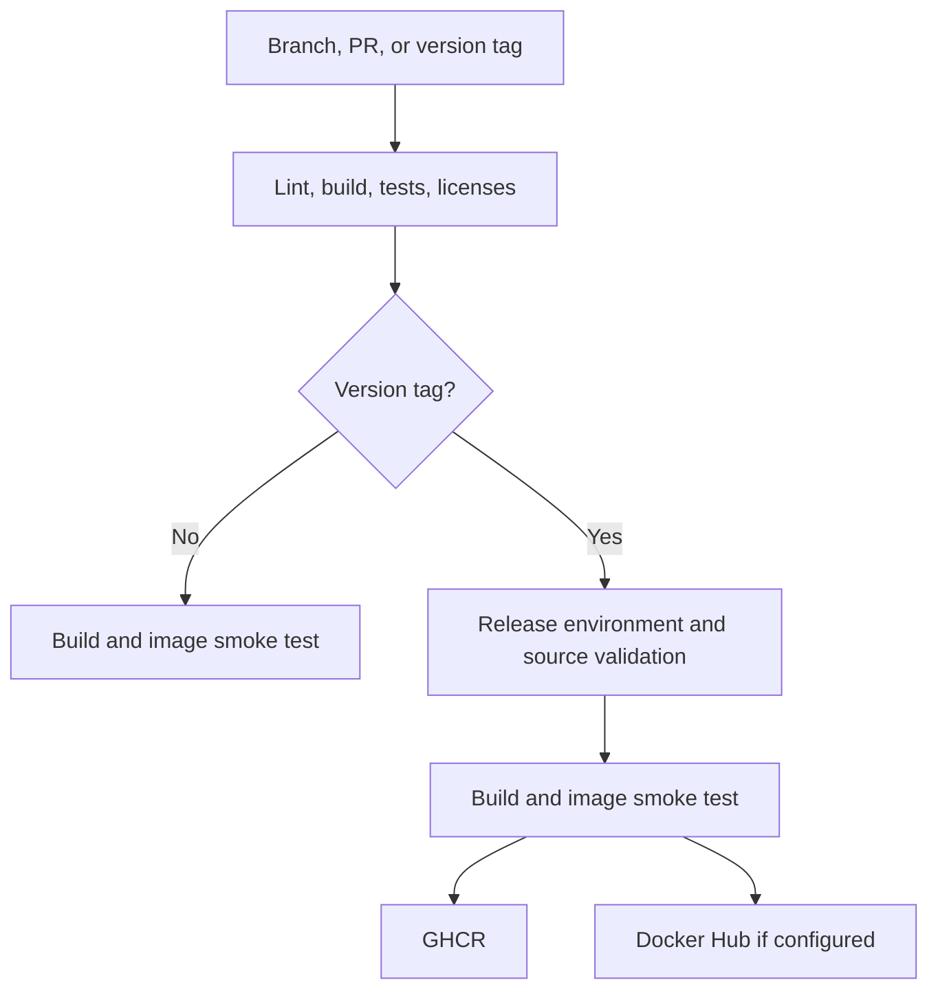

# GitHub Actions とコンテナ公開

[English canonical](ci-github.md) · 日本語 · [GitLab の設定](ci-gitlab.ja.md)

同梱の [workflow](../.github/workflows/ci.yml) は Pull Request とブランチの push を検証し、条件を満たすバージョンタグの push でコンテナを公開します。今回用意したものは自動化の設定です。リポジトリ、package、token の作成や、実際の公開は行っていません。実施済みの検証は [TESTING.md](../TESTING.md) を参照してください。

## 公開先の選択

**ソースを GitHub に置く場合は、GitHub Container Registry（GHCR）を主な公開先にします。** リポジトリの workflow から、その job 用の `GITHUB_TOKEN` で公開でき、Public なイメージは匿名で pull できます。この経路には別の長期保存するレジストリ認証情報が不要です。公開先は、小文字にした `ghcr.io/<owner>/<repository>` です。[GitHub のレジストリ仕様](https://docs.github.com/en/packages/working-with-a-github-packages-registry/working-with-the-container-registry)

Docker Hub は、利用者がその配布経路を必要とする場合に追加できます。このテンプレートでは Hub のリポジトリと専用の認証情報が必要です。この選択理由は認証と運用の統合であり、料金や上限が将来も変わらないという前提ではありません。GitLab にソースを置く場合は [GitLab Container Registry](ci-gitlab.ja.md) を直接利用できます。

## 実行される処理



| Job | 実行条件 | 内容 |
| --- | --- | --- |
| `checks` / **Lint, build, and tests** | Pull Request、各ブランチへの push、`v*` タグの push | `scripts/ci/check.sh` で整形、Clippy、lockfile に従うビルドと Rust の全テスト、CLI、mock Docker API、ライセンスの整合性を検証します。transport テストの除外はしません。 |
| `image` / **Container smoke test** | `checks` 成功後の Pull Request とブランチ push | `linux/amd64` をビルドし、`scripts/ci/test_image.sh` を実行します。レジストリへのログインや push はしません。 |
| `publish` / **Publish release image** | `checks` と `release` environment の条件を満たす、保護された `v*` タグ push | 安定版のバージョンと `Cargo.toml`、デフォルトブランチ上の履歴を確認します。ローカルでビルドと smoke test を行い、同じイメージを再ビルドせずに push します。 |

イメージの smoke test は、Docker socket を渡さず、制限したコンテナ設定で CLI とライセンスファイルを確認します。controller の実際のネットワーク操作を検証するものではありません。[使い捨て Engine と実際の Traefik での受け入れ確認](../TESTING.md) は別に残ります。この設定の対象は `linux/amd64` です。arm64 はビルドと受け入れ確認を追加するまで対応イメージとして案内しません。

## リポジトリの初期設定

1. `Cargo.lock`、`rust-toolchain.toml`、ライセンス資料、`scripts/ci/`、`.github/` を含むプロジェクト一式をリポジトリに commit します。GitHub が提供する `ubuntu-24.04` runner の Python 3、rustup、Docker を使用します。`rustup show` が、このリポジトリで指定した toolchain と component を準備します。
2. Actions を有効にし、固定した公式 `actions/checkout` と `docker/*` actions を許可します。リポジトリ全体の workflow token の標準権限は読み取り専用とし、公開 job だけが `packages: write` を要求します。Organization の設定でも package の作成・公開が許可されている必要があります。
3. デフォルトブランチを保護し、レビューと **Lint, build, and tests**、**Container smoke test** の成功を merge 条件にします。workflow、Dockerfile、ライセンス、CI script の変更も maintainer のレビュー対象にします。status check 名は最初の CI 実行後に選択します。
4. `v*` を対象とする **Active な tag ruleset** を作ります。タグ作成を release maintainer に制限し、更新・削除も保護します。例外を認める対象は必要最小限にします。workflow の履歴確認は「タグの commit が現在のデフォルトブランチから到達できる」ことを調べますが、レビュー規則自体が設定されていることまでは証明しません。[Ruleset の設定](https://docs.github.com/en/repositories/configuring-branches-and-merges-in-your-repository/managing-rulesets/creating-rulesets-for-a-repository)
5. **最初のバージョンタグを push する前に**、**Settings → Environments** で `release` を作ります。公開対象は **Selected branches and tags → Tag → `v*`** に設定します。公開承認が必要な運用では required reviewers も設定します。YAML に environment 名を書くことだけでは保護規則は作られず、GitHub が保護なしで environment を自動作成する場合があります。[Environment の設定](https://docs.github.com/en/actions/how-tos/deploy/configure-and-manage-deployments/manage-environments)
6. 開発用ブランチを push するか Pull Request を作り、check と image smoke のログを確認します。同梱 workflow は本番 Docker daemon を持つ self-hosted runner を使用しません。

GHCR 用の PAT や、自分で作成する `GITHUB_TOKEN` secret は不要です。同じ名前の package が既にある場合は、このリポジトリを関連付け、Actions の書き込み権限を与えます。最初に公開した GHCR package は標準では Private なので、公開配布する場合は最初の push 成功後に package の visibility を **Public** に変更します。ソースが Public というだけでは、イメージを匿名で取得できる確認にはなりません。[Package のアクセス制御と公開範囲](https://docs.github.com/en/packages/working-with-a-github-packages-registry/working-with-the-container-registry)

## Docker Hub にも公開する場合

先に公開先となる Public の Hub リポジトリを作成します。GitHub の repository、または `release` environment に次の値を設定します。secret は environment に置く構成を推奨します。

| 種類 | 名前 | 値 |
| --- | --- | --- |
| Actions variable | `DOCKERHUB_IMAGE` | 小文字の `your-namespace/traefik-network-controller`。registry 名やタグは付けません。未設定なら Hub への公開は無効です。 |
| Actions variable | `DOCKERHUB_USERNAME` | 認証に使用する Docker ID。Organization の namespace と同じである必要はありません。 |
| Actions secret | `DOCKERHUB_TOKEN` | 公開先への push 権限を持つ、有効期限を設定した Hub access token。 |

個人用 token では **Repo Read & Write** に push が含まれます。Delete や Cloud Sandboxes の権限は不要です。個人用 token は単一リポジトリに限定できず、そのアカウントがアクセスできるリポジトリに権限が適用されます。用途を限定したアカウント、または利用条件が合えばリポジトリを限定できる Organization access token を使います。ログイン名には token の種類で指定された identity を設定してください。[Token の作成](https://docs.docker.com/security/access-tokens/personal-access-tokens/) · [権限の範囲](https://docs.docker.com/security/access-tokens/reference/)

Hub の設定が不完全なら公開前に失敗し、設定された両レジストリへのログインが成功してから push します。ただし各書き込みは順番に行うため、全体が一つのトランザクションになるわけではありません。途中で失敗した場合は、別のタグやレジストリへの push が済んでいる可能性があります。記録された digest と各レジストリの状態を確認してから再実行してください。

## リリースの作成

保護したデフォルトブランチに release commit を merge して検証します。新しいバージョンでは `Cargo.toml` / `Cargo.lock`、リリース文書、必要な notice を更新し、[公開手順](releasing.ja.md) の release checklist を完了します。デフォルトブランチが `main` でない場合は読み替えてください。

```sh
git switch main
git pull --ff-only
bash scripts/ci/check.sh
python3 scripts/ci/release_metadata.py v0.2.0
git tag -a v0.2.0 -m "Release 0.2.0"
git push origin v0.2.0
```

タグを push すると、各 gate の成功後に workflow が公開します。GitHub Release ページの作成は任意であり、この設定の実行契機ではありません。package version と完全に一致する安定版の `vMAJOR.MINOR.PATCH` だけを受け付けます。prerelease suffix、先頭のゼロ、バージョン不一致は拒否します。

リポジトリが `your-org/traefik-network-controller` の場合、公開される名前は次のとおりです。

```text
ghcr.io/your-org/traefik-network-controller:0.2.0
ghcr.io/your-org/traefik-network-controller:sha-<full-commit-id>
```

Hub を有効にした場合も同じタグ名を付けます。`latest`、major、minor の移動する alias は作りません。job summary に各レジストリの digest 付き参照を記録するため、取得元と一致する digest を使ってください。`sha-` 形式を含め、タグ名自体に不変性があるわけではありません。同じ commit でも base image が変われば、再ビルドした digest は変わり得ます。配布済みの release を意図的に再ビルドする場合は新しい version を発行し、デプロイ先は digest で固定します。[GHCR の digest 指定](https://docs.github.com/en/packages/working-with-a-github-packages-registry/working-with-the-container-registry#pull-by-digest)

package を Public にした後は、認証情報を持たないクライアントで pull を確認し、バイナリの version と `org.opencontainers.image.source`、`revision`、`version`、`licenses` のラベルを確認します。run URL、source commit、platform、レジストリごとの digest をリリース記録に残します。ライセンスのラベルは本プロジェクトのライセンスを示します。依存ライブラリと Debian package の条件はそれぞれ維持されます。[ライセンスの説明](licensing.ja.md)

## 継続的な更新と検証の範囲

Actions は upstream の完全な commit SHA で固定しています。[Dependabot の設定](../.github/dependabot.yml) は Actions、Cargo の依存関係、Dockerfile のイメージ参照について週次で更新を提案します。自動 merge や公開はしません。依存関係の変更をレビューし、必要なら notice を再生成して確認します。action の固定先は upstream で確認して更新し、変更後のテストを行います。[GitHub の workflow security guidance](https://docs.github.com/en/actions/reference/security/secure-use)

| Action | 確認した version | Upstream commit |
| --- | --- | --- |
| `actions/checkout` | 7.0.1 | [3d3c42e5aac5ba805825da76410c181273ba90b1](https://github.com/actions/checkout/commit/3d3c42e5aac5ba805825da76410c181273ba90b1) |
| `docker/setup-buildx-action` | 4.4.1 | [f87e5991a6d7451dcb8d9637bfbc97413f497069](https://github.com/docker/setup-buildx-action/commit/f87e5991a6d7451dcb8d9637bfbc97413f497069) |
| `docker/build-push-action` | 7.4.0 | [c3c9e263c25d99ce0380d002d59b67737d91b0dc](https://github.com/docker/build-push-action/commit/c3c9e263c25d99ce0380d002d59b67737d91b0dc) |
| `docker/login-action` | 4.8.0 | [8aa5831fb8d48d8f76594c7ddde61ae58019f550](https://github.com/docker/login-action/commit/8aa5831fb8d48d8f76594c7ddde61ae58019f550) |

固定先と仕様は 2026-11-08 JST に upstream で確認しました。これは設定とソースの確認であり、リモート workflow の成功実績ではありません。Action の SHA 固定は、別途ダウンロードするすべてのビルドツールや、標準の base image tag を固定するものではありません。この設定はテストしたローカルイメージを公開して digest を記録しますが、SBOM の添付、イメージ署名、署名付き provenance の生成、完全な再現可能ビルドの証明は行いません。これらを追加するときは、実際に公開された成果物まで含めて検証してください。公開エラーを成功扱いにするために check を省略してはいけません。

### よくある失敗

| 症状 | 確認事項 |
| --- | --- |
| GHCR の push が拒否される | job の `packages: write`、Organization の package policy、package とリポジトリの関連付け・Actions 権限。最初から広範囲な PAT を追加しません。 |
| Release job が待機する | `release` environment の承認と、タグの deployment policy。 |
| Release tag が拒否される・公開が skip される | Active なタグ保護、安定版タグの書式、package version との一致、デフォルトブランチ上の commit 履歴。 |
| Hub のログイン・push が拒否される | token の identity、有効期限、namespace、push 権限。 |
| 依存更新後にライセンス check が失敗する | ライセンス inventory の変更を確認し、ライセンス手順に沿って notice をレビュー・更新します。 |
| Socket テストが失敗する | runner の実行条件またはテストの失敗原因を修正します。CI では transport と mock の全 suite が必要です。 |
