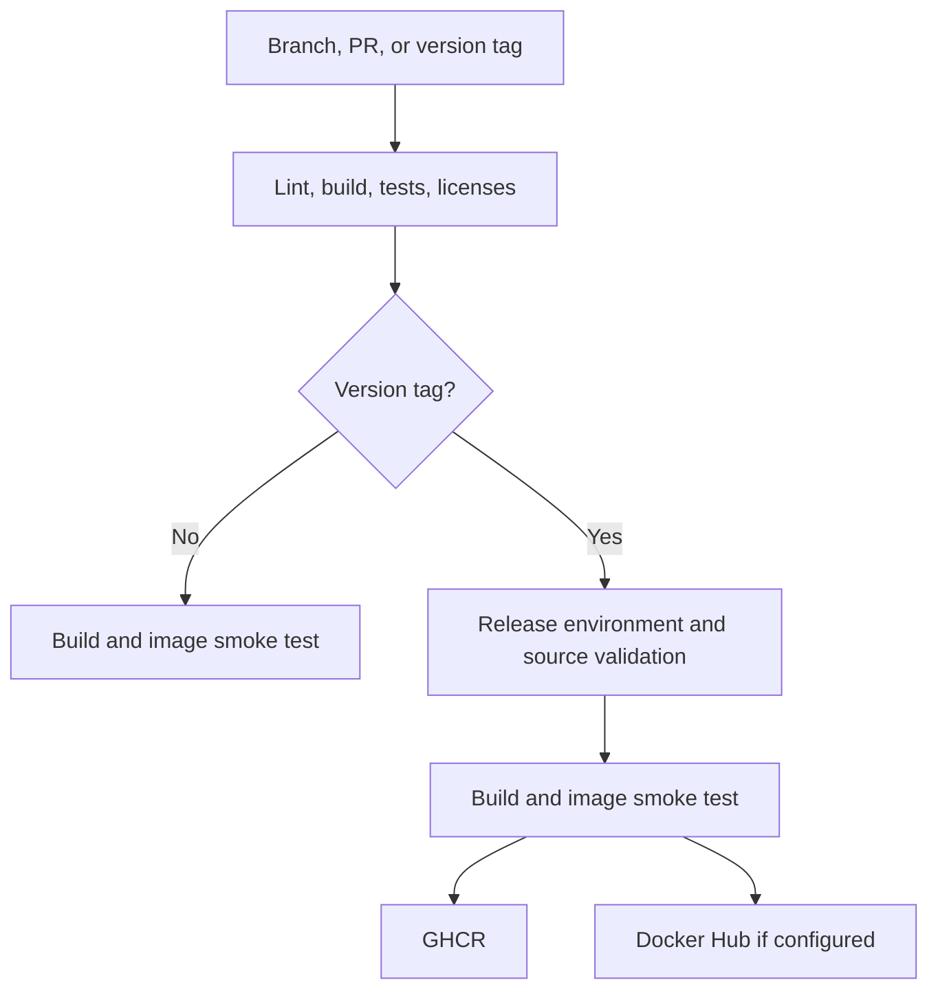

# GitHub Actions and container publication

English canonical · [日本語](ci-github.ja.md) · [GitLab setup](ci-gitlab.md)

The supplied [workflow](../.github/workflows/ci.yml) verifies pull requests and branch pushes, and publishes a container when a qualifying version tag is pushed. These files prepare automation; no repository, package, token, or public release was created while preparing this source bundle. See [TESTING.md](../TESTING.md) for observed validation.

## Registry choice

**Use GitHub Container Registry (GHCR) as the primary registry when GitHub hosts the source.** Its repository workflow can publish with the job-scoped `GITHUB_TOKEN`, and public images can be pulled anonymously. A separate long-lived registry credential is unnecessary for this path. The workflow publishes to `ghcr.io/<owner>/<repository>` with a lowercase path. [GitHub registry documentation](https://docs.github.com/en/packages/working-with-a-github-packages-registry/working-with-the-container-registry)

Docker Hub is an optional additional destination when users need that distribution channel. It requires a Hub repository and its own credential in this template. This recommendation concerns integration and credential management; it does not assume permanent pricing or quota differences. GitLab-hosted projects can use [GitLab Container Registry](ci-gitlab.md) directly.

## What runs



| Job | Trigger | Result |
| --- | --- | --- |
| `checks` / **Lint, build, and tests** | Pull request, any branch push, `v*` tag push | Runs `scripts/ci/check.sh`: formatting, Clippy, locked build/full Rust tests, CLI tests, mock Docker API tests, and license consistency checks. No filtered transport-test subset. |
| `image` / **Container smoke test** | Pull request and branch push, after `checks` | Builds `linux/amd64` and invokes `scripts/ci/test_image.sh`; no registry login or push. |
| `publish` / **Publish release image** | A protected `v*` tag push, after `checks` and the `release` environment policy | Validates the stable version against `Cargo.toml` and ancestry on the default branch; builds and smoke-tests locally, then pushes that same image without rebuilding it. |

The image smoke test exercises the packaged CLI and license files under restricted container settings, without a Docker socket. It does not perform live controller lifecycle tests. The [disposable-Engine and actual Traefik acceptance gates](../TESTING.md) remain separate. Only `linux/amd64` is built here; do not advertise an arm64 image until that platform is built and accepted.

## Initial repository setup

1. Commit the complete project, including `Cargo.lock`, `rust-toolchain.toml`, license materials, `scripts/ci/`, and `.github/`, to the chosen repository. The workflow uses a GitHub-hosted `ubuntu-24.04` runner with Python 3, rustup, and Docker. `rustup show` installs the toolchain and components declared by this repository.
2. Enable Actions and permit the pinned official `actions/checkout` and `docker/*` actions. Keep the repository's default workflow token permissions read-only; only the publication job requests `packages: write`. Organization policy must permit package creation/publication.
3. Protect the default branch. Require review and the **Lint, build, and tests** and **Container smoke test** status checks before merging. Include workflow, Dockerfile, licensing, and CI-script changes in maintainer review. Wait for the first CI run before selecting its check names in repository settings.
4. Create an **active tag ruleset** for `v*`. Restrict tag creation to release maintainers and protect against tag update/deletion; use the smallest appropriate bypass list. The workflow's ancestry check establishes that the tagged commit is reachable from the current default branch, but cannot establish that repository review rules were configured. [Ruleset setup](https://docs.github.com/en/repositories/configuring-branches-and-merges-in-your-repository/managing-rulesets/creating-rulesets-for-a-repository)
5. Under **Settings → Environments**, create `release` **before the first version tag**. Set deployment policy to **Selected branches and tags → Tag → `v*`**. Add required reviewers if release approval is part of your process. Merely naming an environment in YAML does not configure its protection: GitHub can otherwise create it without protection rules. [Environment setup](https://docs.github.com/en/actions/how-tos/deploy/configure-and-manage-deployments/manage-environments)
6. Push a development branch or open a pull request and inspect the complete check and image-smoke logs. The supplied workflow does not use a self-hosted production Docker daemon.

No GHCR PAT or manually created `GITHUB_TOKEN` secret is needed. If a package at the same path already exists, connect it to this repository and grant the repository Actions write access. A first-time GHCR package is private by default; after the first successful publish, change its package visibility to **Public** for public distribution. Public source visibility alone is not sufficient evidence of anonymous image access. [Package access and visibility](https://docs.github.com/en/packages/working-with-a-github-packages-registry/working-with-the-container-registry)

## Optional Docker Hub publishing

Create the intended public Hub repository first. Configure these values in the GitHub repository or, preferably for the secret, its `release` environment:

| Kind | Name | Value |
| --- | --- | --- |
| Actions variable | `DOCKERHUB_IMAGE` | `your-namespace/traefik-network-controller`, lowercase, without registry prefix or tag. Leaving it unset disables Hub publishing. |
| Actions variable | `DOCKERHUB_USERNAME` | Docker ID used to authenticate; it need not equal an organization namespace. |
| Actions secret | `DOCKERHUB_TOKEN` | Expiring Hub access token with push permission for the destination. |

For a personal token, **Repo Read & Write** includes push; delete and Cloud Sandboxes access are unnecessary. A personal token is not restricted to one repository: its permissions apply to repositories the account can access. Use an appropriately restricted account, or a repository-scoped organization access token when available and suitable. Use the login identity prescribed for that token type. [Docker token creation](https://docs.docker.com/security/access-tokens/personal-access-tokens/) · [Permission scopes](https://docs.docker.com/security/access-tokens/reference/)

The workflow rejects an incomplete Hub configuration before publishing and logs in to both configured registries before pushing. Registry writes are still sequential, not atomic: if one push fails, another tag or registry may already contain the image. Check the recorded digests and each registry before retrying.

## Create a release

Merge and verify the release commit on the protected default branch. For a new version, update `Cargo.toml`/`Cargo.lock`, release documentation and notices as required, then complete the release checklist in [the publication guide](releasing.md). Use the actual default branch name if it differs from `main`.

```sh
git switch main
git pull --ff-only
bash scripts/ci/check.sh
python3 scripts/ci/release_metadata.py v0.2.0
git tag -a v0.2.0 -m "Release 0.2.0"
git push origin v0.2.0
```

Pushing the tag authorizes the configured workflow to publish after its gates pass. Creating a GitHub Release page is optional and is not the trigger. This template accepts only stable `vMAJOR.MINOR.PATCH` tags exactly matching the package version; prerelease suffixes, leading zeroes and mismatches fail validation.

For repository `your-org/traefik-network-controller`, the output is:

```text
ghcr.io/your-org/traefik-network-controller:0.2.0
ghcr.io/your-org/traefik-network-controller:sha-<full-commit-id>
```

The optional Hub destination receives the same tag names. No `latest`, major, or minor moving aliases are published. The job summary records registry digest references; use the digest belonging to the registry you consume. Tags, including the `sha-` naming convention, are not inherently immutable. Rebuilding against changed base images can change the digest even at the same source commit. Publish a new version for an intentional rebuild of an already distributed release, and pin deployments by digest. [GHCR digest pulls](https://docs.github.com/en/packages/working-with-a-github-packages-registry/working-with-the-container-registry#pull-by-digest)

After making the package public, test a pull from a client that has no registry credentials, then check the binary version and the `org.opencontainers.image.source`, `revision`, `version`, and `licenses` labels. Keep the run URL, source commit, platform, and per-registry digest with the release record. The license label describes this project's license; included dependencies and Debian packages retain their own terms as described in [licensing](licensing.md).

## Maintenance and scope of evidence

Actions use full upstream commit SHAs. [Dependabot configuration](../.github/dependabot.yml) proposes weekly updates for Actions, Cargo dependencies, and Dockerfile image references; it does not merge or release them. Review dependency changes and regenerate/review notices when required. Update action pins from their upstream repositories and test the change. [GitHub's workflow security guidance](https://docs.github.com/en/actions/reference/security/secure-use)

| Action | Reviewed version | Upstream commit |
| --- | --- | --- |
| `actions/checkout` | 7.0.1 | [3d3c42e5aac5ba805825da76410c181273ba90b1](https://github.com/actions/checkout/commit/3d3c42e5aac5ba805825da76410c181273ba90b1) |
| `docker/setup-buildx-action` | 4.4.1 | [f87e5991a6d7451dcb8d9637bfbc97413f497069](https://github.com/docker/setup-buildx-action/commit/f87e5991a6d7451dcb8d9637bfbc97413f497069) |
| `docker/build-push-action` | 7.4.0 | [c3c9e263c25d99ce0380d002d59b67737d91b0dc](https://github.com/docker/build-push-action/commit/c3c9e263c25d99ce0380d002d59b67737d91b0dc) |
| `docker/login-action` | 4.8.0 | [8aa5831fb8d48d8f76594c7ddde61ae58019f550](https://github.com/docker/login-action/commit/8aa5831fb8d48d8f76594c7ddde61ae58019f550) |

Pins and documentation were checked against upstream on 2026-11-08 JST. These are configuration/source checks, not a successful remote workflow run. Action SHA pins do not pin every downloaded build tool or the default base-image tags. This template publishes a tested local image and records its digest; it does not attach an SBOM, sign the image, generate a signed provenance statement, or prove bit-for-bit reproducible builds. Those are separate extensions requiring verification of the final published artifact. No publication failure should be converted into success by skipping a check.

### Common failures

| Symptom | Check |
| --- | --- |
| GHCR push denied | Job `packages: write`, organization package policy, and the package's repository/Actions access. Do not add a broad PAT as the first fix. |
| Release job waits | `release` environment approvals and tag deployment policy. |
| Release tag rejected or publication skipped | Active tag protection, stable tag syntax, exact package version, and commit ancestry on the default branch. |
| Hub login/push rejected | Correct token identity, expiry, destination namespace and push permission. |
| License check fails after a dependency update | Inspect the changed license inventory and update reviewed notices through the licensing workflow. |
| Socket tests fail | Fix the runner/runtime capability or test failure; CI must run the full transport and mock suites. |
