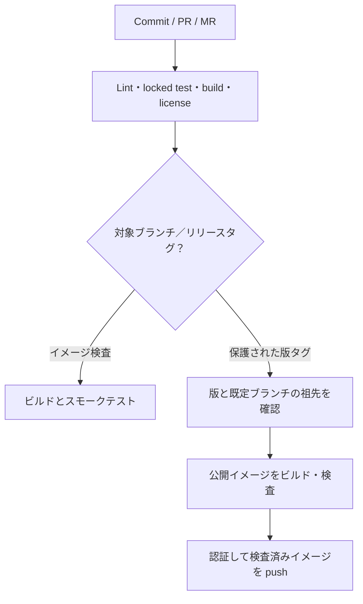

# 公開と CI の設定

[English](releasing.md) · [ライセンス評価](licensing.ja.md) · [GitHub 設定](ci-github.ja.md) · [GitLab 設定](ci-gitlab.ja.md)

このソース一式には MIT ライセンスと両 CI の設定を含みます。リモートリポジトリの作成、保護設定の有効化、イメージの公開、CI の実行完了は別です。controller の契約は **0.2.0** を維持します。実施した検証と実環境の未完了項目は [TESTING.md](../TESTING.md) に記録します。

## 公開先の選択

| ソース／CI | 推奨するイメージ公開先 | 認証 |
| --- | --- | --- |
| GitHub | GHCR (`ghcr.io/<owner>/<repository>`) | ジョブの短期 `GITHUB_TOKEN`。package 書き込み権限は公開ジョブに限定。 |
| GitHub、Docker Hub にも配布したい場合 | GHCR と任意の Docker Hub | GitHub token と、secret に保存する Docker Hub access token。 |
| GitLab | 同じプロジェクトの `$CI_REGISTRY_IMAGE` | GitLab がジョブごとに発行する registry 用のユーザー名／パスワード。 |

GitHub で管理するなら、まず GHCR を勧めます。リポジトリと関連付けでき、別サービスの長期認証情報が不要です。public の GHCR イメージは匿名で pull できますが、package の公開範囲は別途設定します。Docker Hub は利用者がそこでの配布を必要とする場合の追加先に向いており、認証情報と公開結果の管理が増えます。GitLab CI では同じプロジェクトの Registry が自然です。これは運用上の選択であり、registry の選択だけで controller が安全になるという意味ではありません。[GitHub の公式説明](https://docs.github.com/en/packages/working-with-a-github-packages-registry/working-with-the-container-registry) と [GitLab の認証説明](https://docs.gitlab.com/user/packages/container_registry/authenticate_with_container_registry/) を参照してください。

## パイプラインの処理



イベント条件には差があります。GitHub は PR／ブランチでもイメージを検査し、GitLab の privileged なコンテナジョブは保護した既定ブランチとリリースタグに限定します。両サービスとも、対象の PR／MR・ブランチ・タグで完全なソース検査を実行します。runner と権限の範囲は個別の設定手順を参照してください。

共通のソース検査は次です。

```sh
bash scripts/ci/check.sh
```

`cargo fmt`、固定依存関係の取得、ライセンス表示の検査、警告を拒否する Clippy、**全** Rust テスト、最適化ビルド、CLI のスモークテスト、Unix ソケットの Docker API モック、公開タグの検査テストを実行します。ソケットテストを省略しません。Linux、固定 Rust と rustfmt／Clippy、Python **3.11 以上**、一時 Unix ソケットの bind 許可が必要です。これらは実 Docker Engine へ接続しません。

コンテナジョブは [Dockerfile](../Dockerfile) から `linux/amd64` をビルドし、`scripts/ci/test_image.sh IMAGE_REF` を実行します。ソケット・ホストディレクトリ・認証情報・状態 volume を渡さず、rootfs 読み取り専用、ネットワークなし、capability 削除、no-new-privileges で版・capabilities・同梱ライセンス・プロジェクトの license label を確認します。実 Engine のライフサイクル、Traefik、WAF、通信分離の受入とは別です。

公開ジョブは、その検査済みのローカルイメージにタグを付けて push します。検査後に別のイメージを作り直しません。完全な版と完全なコミットのタグを作り、`latest`、major、minor の別名は自動作成しません。タグは変更可能なので、導入には確認済みの registry digest を記録して使います。署名、SBOM／provenance attestation、脆弱性スキャンは現時点のパイプラインに含みません。

## 管理者の公開手順

1. [GitHub](ci-github.ja.md) または [GitLab](ci-gitlab.ja.md) の手順で、ブランチ／タグ保護、runner、registry 権限、公開範囲を設定します。ソースと package の公開範囲は別です。
2. 対象コミット、[ライセンス](licensing.ja.md)、[変更履歴](../CHANGELOG.md)、[SPEC](../SPEC.ja.md)、[検証結果](../TESTING.md) を確認します。Cargo.toml、CLI／schema／文書、toolchain、確認済みライセンス表示を一致させ、依存関係・Action・ベースイメージの更新もレビューします。
3. 必要な権限のある環境で全検査を通し、対象のイメージ／Engine／通信の受入を行います。実環境の検査を残してソースのプレビューを公開する場合は、本番受入済みと区別します。
4. 保護された既定ブランチへマージし、Cargo.toml と一致する新しい安定版タグを作ります。既存のリリースタグを強制移動しません。

```sh
# Example for this source version, after the above checks and repository setup.
python3 scripts/ci/release_metadata.py v0.2.0
git tag -a v0.2.0 -m 'Release 0.2.0'
git push origin v0.2.0
```

5. タグのパイプライン、公開した digest、image label、package の公開範囲を確認します。公開用途の場合だけ匿名 pull も確認します。GHCR と Docker Hub を併用する場合は両方の結果を確認します。複数サービスへの公開は一つのトランザクションにはなりません。
6. 選んだ digest を設定し、[運用手順](operations.ja.md) に従って導入します。イメージ公開だけでは controller の導入や Docker ネットワーク変更は発生しません。

`scripts/ci/release_metadata.py TAG` は安定版 `vMAJOR.MINOR.PATCH` のみを受け付け、先頭ゼロ、prerelease、build metadata を拒否し、Cargo.toml と照合します。標準出力は通常 JSON、`--format github` は `GITHUB_OUTPUT` 用、`--format dotenv` は GitLab 用です。版検査はレビューやサービス側の保護設定を代替しません。

## 失敗、切り戻し、保守

- テストや表示の検査が失敗すると公開を止めます。原因を修正し、検査の省略や別経路の未検査イメージ公開で回避しません。ライセンス表示の再生成はレビューを伴う手順で行い、CI が自動承認しません。
- push の一時障害時は、各 registry に存在するタグ／digest を調べてから再試行します。現在の設定は registry 側のタグ不変性や再ビルドの完全な同一性を保証せず、ベースイメージのタグも変化し得ます。利用中の公開イメージを通常の修復として上書きしません。
- 切り戻しは受入済みの旧 digest を選び、運用ガイドの状態／互換性確認を行います。状態 volume を維持し、イメージを戻すために所有権をリセットしません。
- GitHub Action は commit SHA で固定しています。Docker／Rust のベースと CI イメージは確認済みの明示的な版タグを使いますが変更可能です。リリース保守で承認済み digest に固定・更新し、実際のビルドと registry の証拠を保持します。未確認の digest は設定に捏造しません。
- MIT は本プロジェクトの独自部分に適用します。依存関係、Rust ランタイム、Debian の表示も適用されます。OCI の `licenses=MIT` はプロジェクトの表示であり、イメージ内の全ファイルが MIT という意味ではありません。

AI に依頼する場合は [公開準備プロンプト](../prompts/prepare-release.ja.md) を使います。token をプロンプト、追跡するファイル、build argument、イメージ層、CI ログへ書き込まないでください。
