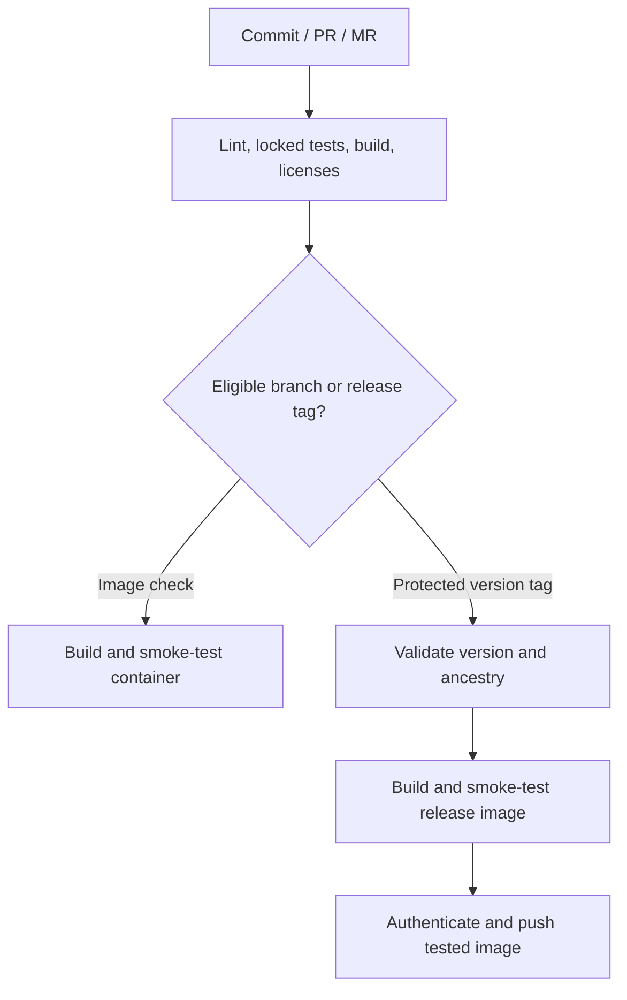

# Public distribution and CI

[日本語](releasing.ja.md) · [License assessment](licensing.md) · [GitHub setup](ci-github.md) · [GitLab setup](ci-gitlab.md)

This source package includes MIT licensing and both CI configurations. It does not create a remote repository, enable repository protections, publish an image, or prove that a hosted pipeline has run. The controller contract remains **0.2.0**. [TESTING.md](../TESTING.md) records observed validation and the separate live deployment gates.

## Choose the registry

| Source/CI location | Recommended image destination | Authentication |
| --- | --- | --- |
| GitHub | GHCR (`ghcr.io/<owner>/<repository>`) | Short-lived workflow `GITHUB_TOKEN`; package write permission only in the publish job. |
| GitHub, with a separate Docker Hub audience | GHCR plus optional Docker Hub | GitHub token plus a Docker Hub access token stored as a secret. |
| GitLab | The project's `$CI_REGISTRY_IMAGE` | GitLab's per-job registry username/password. |

For a GitHub-hosted project, start with GHCR. It associates the image with the repository and avoids a separate long-lived registry credential. Public GHCR images support anonymous pulls; package visibility must be configured separately. Docker Hub is useful as an additional distribution channel when the intended users need it, but adds credentials and another publication result to maintain. GitLab CI naturally uses its own project's registry. These are operational choices, not claims that one registry makes the controller itself safer. See the official [GitHub registry documentation](https://docs.github.com/en/packages/working-with-a-github-packages-registry/working-with-the-container-registry) and [GitLab authentication documentation](https://docs.gitlab.com/user/packages/container_registry/authenticate_with_container_registry/).

## What the pipelines do



The exact event rules differ: GitHub checks container builds on PRs/branches as well; GitLab reserves privileged container jobs for the configured protected default branch and release tags. Both providers run the full source gate on supported PR/MR, branch and tag events. See their setup pages for the runner and permission boundary.

The common source gate is:

```sh
bash scripts/ci/check.sh
```

It runs `cargo fmt`, fetches the locked dependencies, checks retained license notices, runs Clippy with warnings denied, **all** Rust tests, the optimized build, the CLI smoke suite, the Unix-socket Docker API double, and the release-tag guard tests. There are no socket-test skips. Requirements: Linux, the pinned Rust toolchain and its rustfmt/Clippy components, Python **3.11+**, and permission to bind temporary Unix sockets. These tests do not contact a real Docker Engine.

Container jobs use [Dockerfile](../Dockerfile), build `linux/amd64`, then run `scripts/ci/test_image.sh IMAGE_REF`. The smoke runs without a socket, host directory, credentials or state volume, using a read-only rootfs, no network, dropped capabilities and no-new-privileges. It checks version, capabilities, packaged notices and the project license label. It is **not** lifecycle, actual Traefik, WAF or traffic-isolation acceptance.

The publish job tags and pushes that same tested local image. Neither pipeline rebuilds a different image after the smoke. Full version and full commit tags are published; `latest`, major and minor aliases are deliberately absent. A tag is still a mutable name: deployments should record and use the verified registry digest. The pipelines do not yet generate signatures, SBOM/provenance attestations, or vulnerability-scan results.

## Maintainer release sequence

1. Configure the selected provider using [GitHub](ci-github.md) or [GitLab](ci-gitlab.md), including branch/tag protections, runner trust, registry access and public visibility. Repository source visibility and package visibility are separate decisions.
2. Review the exact source commit, [licensing](licensing.md), [change history](../CHANGELOG.md), [SPEC](../SPEC.md) and [test evidence](../TESTING.md). Keep `Cargo.toml`, CLI/schema/docs, toolchain and reviewed notices consistent. Review dependency/action/base-image updates as source changes.
3. Run the full gate in a capable environment and accept the applicable container/Engine/traffic gates. Keep source-preview publication clearly distinguished from production acceptance if live gates remain open.
4. Merge to the protected default branch. Use a new stable tag whose version equals `Cargo.toml`. Do not force-move an existing release tag.

```sh
# Example for this source version, after the above checks and repository setup.
python3 scripts/ci/release_metadata.py v0.2.0
git tag -a v0.2.0 -m 'Release 0.2.0'
git push origin v0.2.0
```

5. Inspect the tag pipeline, published registry digest, image labels and package visibility. Test an anonymous pull only when public access is intended. Where both GHCR and Docker Hub are enabled, verify both results: registry publication is not atomic across services.
6. Put the chosen digest into the deployment configuration and follow [operations](operations.md). Publication does not automatically deploy the controller or modify Docker networks.

`scripts/ci/release_metadata.py TAG` accepts only stable `vMAJOR.MINOR.PATCH`, with no leading zeros, prerelease suffix or build metadata, and compares it with the source manifest. It emits JSON by default, `--format github` for `GITHUB_OUTPUT`, or `--format dotenv` for GitLab. Version checks do not replace review or provider-side protection.

## Failed runs, rollback and maintenance

- A failed test or notice check stops publication. Diagnose the cause; do not add skips or publish with a different untested path. License refresh uses the documented review process, never blind regeneration in CI.
- For a transient push failure, check which registry/tag/digest already exists before retrying. The current files do not guarantee registry-side tag immutability or byte-identical rebuilds; base-image tags can change. Never overwrite an image already relied on by users as an ordinary repair.
- Roll deployments back by selecting a previously accepted digest and following the state/compatibility checks in the operations guide. Keep the state volume; reverting an image is not a reason to reset ownership.
- GitHub Actions are commit-pinned. Docker/Rust base and CI images use verified explicit version tags, which remain mutable. Pin approved digests when maintaining a release, keep them refreshed, and retain actual build/registry evidence. The initial package does not invent unobserved image digests.
- The MIT license covers this project's original contributions. Dependency, Rust-runtime and Debian notices remain applicable. The OCI `licenses=MIT` label describes the project and is not an assertion that all image files are MIT.

Use the [release preparation prompt](../prompts/prepare-release.md) for agent-assisted work. Never put access tokens into a prompt, tracked file, build argument, image layer or CI log.
