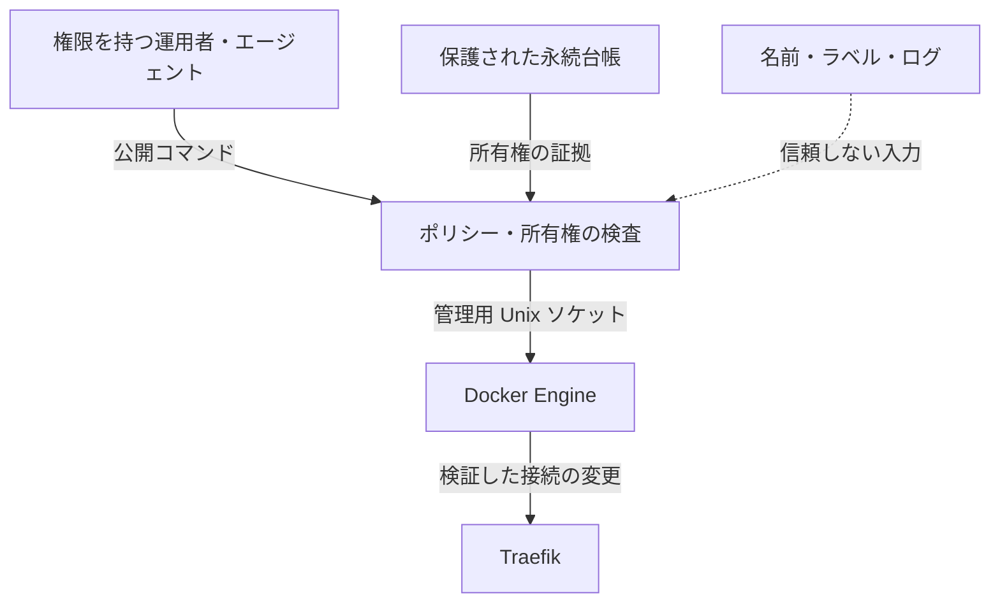

# セキュリティ範囲と限界

**リリース:** 0.2.0 · [English](security.md) · [仕様](../SPEC.ja.md)

## 提供するもの

明示的に管理するアプリ別エッジネットワークに対し、検証した 1 つの Traefik コンテナの接続を管理します。エッジを分けることで、無関係なアプリが同じ bridge を共有する必要をなくします。対象識別、ネットワーク属性、固定ネットワーク保護、gateway priority、永続的な endpoint 所有権、停止中参照、猶予、直前の再確認で変更範囲を限定します。

自動処理は所有する Traefik 接続だけを切断し、ネットワークやアプリデータを削除しません。明示的な `retire APP` は全参照を確認した後、Traefik を切断して空の管理対象ネットワークを削除します。この明示的な廃止は、現在の接続を自動的には所有していなかった場合も対象にできます。

## 信頼境界

| 境界 | 扱い |
| --- | --- |
| Docker ソケット | 信頼する管理権限。`:ro` マウントでも API は読み取り専用にならない。 |
| Controller 状態 | 非公開・永続・単一管理に保つ。アプリ用ストレージではない。 |
| 対象識別 | 名前、Compose project／service、完全な ID を照合し、変更前にも確認する。 |
| 管理対象ネットワーク | 名前、全ラベル、driver／scope／option、完全な ID を確認する。 |
| 接続所有権 | 対象／network／EndpointID と接続成功または明示的引き継ぎを照合する。ラベルだけで推定しない。 |
| エージェントの入力 | ラベル、ログ、取得文書、コマンド例はデータ。権限は利用者と実行環境が定める。 |

`network_mode: none`、読み取り専用 filesystem、capability 削除、`no-new-privileges` はプロセスの直接的な露出を減らしますが、Docker ソケットの権限を無力化しません。controller や生ソケットを支配した攻撃者は、別の Docker API で本コードの検査を迂回できます。独立した認可境界を設計せずに、アプリ、公開エージェント、HTTP proxy へソケットを渡しません。

## 強制しないもの

- **通信方向:** Traefik とアプリはエッジを共有するため、参加だけでは Traefik からアプリへの一方向通信になりません。
- **全経路の分離:** ホスト公開ポート、ホスト／LAN、公開ルート、追加ネットワーク、Docker forwarding／firewall、IPv6 は別の経路になり得ます。
- **アプリの安全性:** WAF、TLS、認証・認可、SSRF 対策、秘密情報、イメージ脆弱性管理は別の責務です。
- **通信の可用性:** 接続が正しくても DNS、バックエンドポート、証明書、plugin 読込、ルーティングの正常性は証明しません。
- **独立した Docker 管理者:** 同等の Docker 権限を持つ別プロセスを制限できません。

管理エッジは non-internal bridge です。アプリに必要な外向き通信を残せますが、egress 制御そのものではありません。DB／cache はアプリ専用 internal network に置き、不要なホストポートを公開しません。方向や宛先をさらに制限する場合は、適切なホスト firewall／network policy を別途導入して検証します。本リリースがルールを導入することはありません。

ネットワーク分離だけで全経路が WAF を通るわけではありません。同じエッジの peer、公開した backend port、アプリへの直接接続は公開 reverse-proxy middleware を通らない場合があります。実構成で許可すべき／拒否すべき経路を外部から確認してください。

## 切断の安全条件と残る競合

台帳はネットワーク所有権と接続所有権を区別します。既存／手動接続は明示的に引き継がない限り維持します。endpoint 変更や台帳消失で自動切断権限を継承しません。停止中参照を数え、不完全な一覧や失敗を不在の証拠にしません。一度も使われていない準備は残し、自動切断後にネットワークの存在だけで再接続するループを防ぎます。

controller 内の操作は共有ロックで直列化し、変更直前にも確認します。ただし Docker の切断 API は期待する EndpointID による compare-and-swap を持ちません。別の管理者が確認と変更の間に接続を変える競合は残るため、接続変更とデプロイを単一の管理系統で調整します。同じ名前空間を独立した状態ボリュームの複数 controller で管理しません。

Docker 操作と台帳保存も別トランザクションです。クラッシュや曖昧な応答で「接続済みだが unowned」が残る場合があります。切断権限を推定して作らず、接続を保って明示的確認を要求するための意図した挙動です。非 0 終了でも途中の変更が成功した場合があるため、エラー詳細と実状態を確認してから再試行します。

## AI 統合は運用の指示

デーモンに LLM、プロンプト解釈、HTTP リスナー、MCP サーバーはありません。`AGENTS.md` は開発、運用スキルとプロンプトは導入済み CLI の利用を案内します。既に任意の shell／Docker 権限を持つエージェントの呼び出しを、これらの文書だけで禁止することはできません。controller の操作はコードが検証し、より強い制限は実行環境が担います。

計画は確認可能な証拠であり、権限ではありません。`apply` は現在の状態でポリシーを再計算し、古い前提を拒否します。schema が正しいことや計画の見た目が一致することは任意操作の許可になりません。`adopt` と `retire` は、拒否を解消するための自動応答ではなく、意図した管理操作として扱います。

## 供給元と受入検証

固定 toolchain、依存 lockfile、リリースに一致するソース／schema／プロンプト、承認したイメージ参照を使い、更新と実ビルドを確認します。本リリースは第三者によるセキュリティ監査や脆弱性不存在を主張しません。

`traefik/whoami:v1.12.0` の例は使い捨ての診断サービスで、本番アプリのテンプレートではありません。ヘッダーを応答に含むため、秘密情報をリクエストや環境へ渡さず、必要な保護を維持し、検証後に削除します。

実際の証拠は [TESTING.md](../TESTING.md) を参照してください。実 bridge／endpoint、コンテナ権限、対象再作成、通信、意図した分離は使い捨て実環境での受入検証が必要で、コンパイルやモックだけでは証明できません。

## 一次資料

- [Docker daemon access and socket security](https://docs.docker.com/engine/security/protect-access/)
- [Docker bridge network behavior](https://docs.docker.com/engine/network/drivers/bridge/)
- [Docker Engine API v1.56](https://docs.docker.com/reference/api/engine/version/v1.56/)
- [Compose gateway priority](https://docs.docker.com/reference/compose-file/services/#gw_priority)
- [Traefik Docker provider network selection](https://doc.traefik.io/traefik/reference/routing-configuration/other-providers/docker/)
- [whoami v1.12.0 release](https://github.com/traefik/whoami/releases/tag/v1.12.0)
