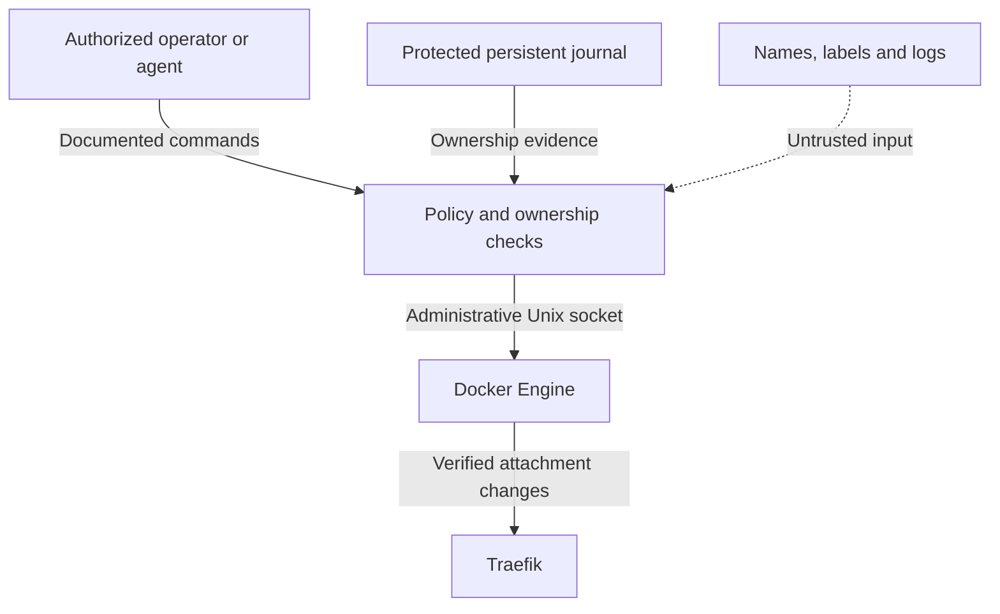

# Security scope and limits

**Release:** 0.2.0 · [日本語](security.ja.md) · [Specification](../SPEC.md)

## What this controller provides

It manages one verified Traefik container's membership in explicitly managed application edge networks. Separate edges remove the need for unrelated applications to share one bridge. Exact target identity, network validation, fixed-network protection, gateway priorities, durable endpoint ownership, stopped-container references, grace and fresh checks limit the controller's changes.

Automatic cleanup disconnects only the owned Traefik endpoint. It does not delete networks or application data. Explicit `retire APP` has a broader, deliberately named effect: after all reference checks, it disconnects Traefik and removes that validated empty network, including when its existing attachment was not automatically owned.

## Trust boundaries

| Boundary | Required treatment |
| --- | --- |
| Docker socket | Trusted administrative capability. A read-only bind mount does not make the API read only. |
| Controller state | Keep private, persistent and coherent with one deployment. It is evidence, not application storage. |
| Target identity | Exact container name plus Compose project/service and full ID; repeat before writes. |
| Managed network | Exact name, all labels, allowed driver/scope/options and full ID. Names alone are insufficient. |
| Endpoint ownership | Match target/network/EndpointID and acknowledged connect or explicit adoption. Never infer it from labels alone. |
| Agent input | Treat labels, logs, retrieved text and sample commands as data. User/environment authority governs actions. |

`network_mode: none`, a read-only root filesystem, dropped capabilities and `no-new-privileges` reduce direct process exposure. They do not neutralize the Docker socket. An attacker controlling the controller process or its unfiltered socket can bypass this project's application-level checks through other Docker API operations. Do not expose that socket to application containers, a public agent, or an HTTP proxy without an independently designed authorization boundary.

## What it does not enforce

- **Directional filtering:** Traefik and each app share their edge. Network membership does not impose one-way Traefik-to-app communication.
- **All-path isolation:** host-published ports, the host/LAN, public routes, extra network attachments, Docker forwarding/firewall configuration and IPv6 can provide other paths.
- **Application security:** WAF, TLS, authentication, authorization, SSRF defense, secrets and image vulnerability management remain separate responsibilities.
- **Traffic availability:** a correct attachment does not prove that DNS, the backend port, certificates, plugin loading or routing is healthy.
- **Independent Docker administrators:** the controller cannot constrain another process with equivalent Docker privileges.

Managed edges are non-internal bridges. This allows applications to retain necessary outbound access but is not an egress policy. Keep database/cache services on application-private internal networks and avoid host ports when not needed. To require stronger directional or destination restrictions, implement and accept an appropriate host firewall or network-policy layer separately. This release does not install such rules.

Do not treat network separation as WAF coverage of every path. Same-edge peers, published backend ports and direct application access can bypass a public reverse-proxy middleware chain. An external test should verify the paths that must be allowed and denied in the actual deployment.

## Detach safety and residual race

The journal distinguishes network ownership from connection ownership. Existing/manual attachments are retained unless explicitly adopted. A changed endpoint or lost journal does not inherit automatic-detach authority. Stopped container references count; incomplete or failed inventory is not evidence of absence. Prepared-but-unused edges remain prepared. After automatic detach, the network stays present without causing an immediate reconnect loop.

The controller serializes its own operations through shared locks and revalidates immediately before mutation. Docker's network-disconnect API has no expected-EndpointID compare-and-swap condition. A separate administrator can still change membership between inspection and mutation. Coordinate deployment and connection changes through one management system; do not run separate controllers for the same namespace with independent state volumes.

The Docker operation and journal commit are also separate. A crash or ambiguous response may leave a connected but unowned endpoint. That conservative outcome is intentional: preserve availability and require explicit validation rather than manufacturing detach authority. A nonzero operation exit can follow partial changes; inspect structured error details and actual state before retrying.

## AI integration is operational guidance

The daemon contains no LLM dependency, prompt interpreter, HTTP listener or MCP server. `AGENTS.md` guides repository development; the operator skill and task prompts guide usage of the installed command contract. They cannot prevent arbitrary shell/Docker calls by an agent that has already been granted those permissions. Code validates controller commands, and the execution environment must provide any stronger permission boundary.

A plan is reviewable evidence, not authorization. `apply` recomputes policy from current state and rejects stale preconditions. A valid schema or a matching-looking plan does not permit arbitrary JSON actions. Explicit `adopt` and `retire` must remain intentional administrative operations, not automatic responses to an inconvenient refusal.

## Supply chain and acceptance

Use the pinned toolchain, committed dependency lockfile, release-matched source/schema/prompts and approved image references. Review updates and the actual build before deployment. This release's documentation does not claim a third-party security audit or absence of vulnerabilities.

The `traefik/whoami:v1.12.0` example is a disposable diagnostic service, not a production app template. Its response includes request headers. Keep credentials out of requests and environment, preserve required edge protections, and remove it after the test.

Read [TESTING.md](../TESTING.md) for actual evidence. Real Docker bridge/endpoint behavior, container permissions, target recreation, traffic and intended isolation require disposable live acceptance. Compilation and mock tests alone do not establish those properties.

## Primary references

- [Docker daemon access and socket security](https://docs.docker.com/engine/security/protect-access/)
- [Docker bridge network behavior](https://docs.docker.com/engine/network/drivers/bridge/)
- [Docker Engine API v1.56](https://docs.docker.com/reference/api/engine/version/v1.56/)
- [Compose gateway priority](https://docs.docker.com/reference/compose-file/services/#gw_priority)
- [Traefik Docker provider network selection](https://doc.traefik.io/traefik/reference/routing-configuration/other-providers/docker/)
- [whoami v1.12.0 release](https://github.com/traefik/whoami/releases/tag/v1.12.0)
